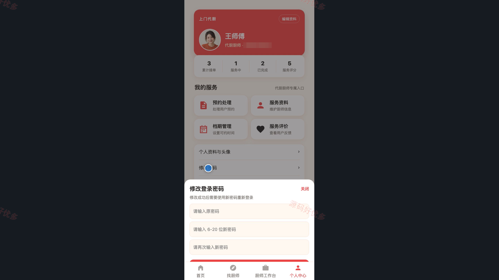
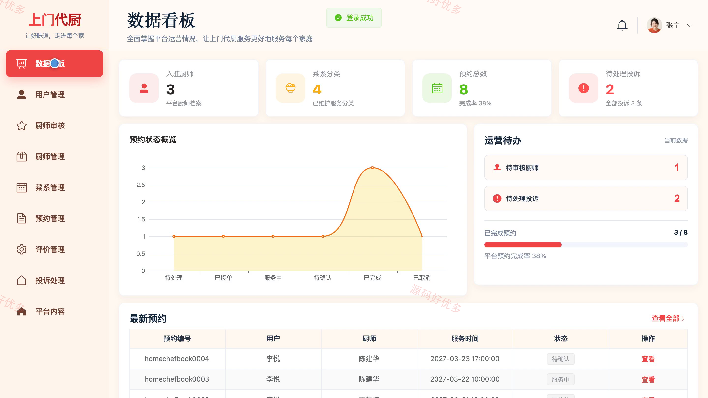
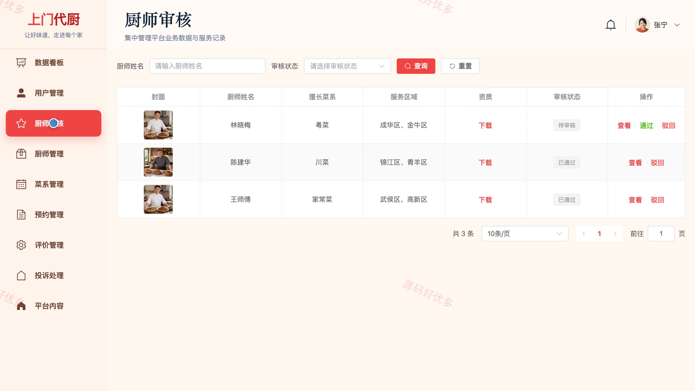
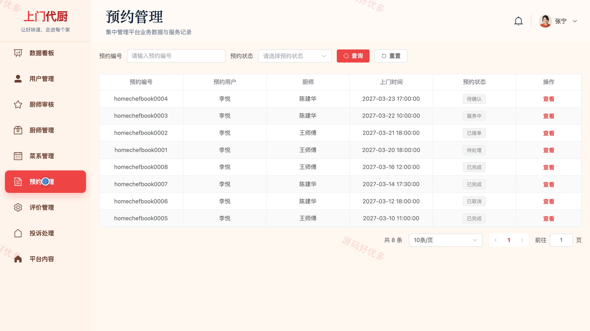

# bs116B
bs116B上门代厨厨师预约平台
## 源码问题查看主页咨询

### 一、关键词
上门代厨、厨师预约、家宴服务、上门做饭、厨师档期

### 二、作品包含
源码+数据库+万字设计文档+PPT+全套环境和工具资源+本地部署教程

### 三、项目技术
前端技术： Html、Css、Js、Vue3.4、Element-Plus、uniapp
后端技术：Java、SpringBoot3.2.0、MyBatis-Plus

### 四、运行环境要求
开发工具：IDEA/eclipse + VSCODE + HBuilder X + 微信开发者工具

数据库：MySQL5.7+（共12张表）

数据库管理工具：Navicat10以上版本

环境配置软件： JDK17 + Maven3.6

前端Nodejs：20

浏览器：谷歌浏览器

### 五、项目介绍
项目编号：bs116B

上门代厨厨师预约小程序连接预约用户、代厨厨师和系统管理员，覆盖厨师查询、档期选择、上门预约、订单处理与服务评价。厨师可维护服务资料和可预约档期，管理员负责厨师审核、预约、用户、菜系及平台内容管理。

角色：预约用户、代厨厨师、系统管理员

预约用户功能：小程序登录与注册、厨师列表与详情浏览、厨师档期查询、上门代厨预约提交、预约记录与详情查询、服务评价与投诉、个人资料维护。

代厨厨师功能：小程序身份登录、厨师工作台、服务资料维护、可预约档期管理、预约订单处理、服务评价查看、个人资料维护。

系统管理员功能：后台登录与数据看板、厨师资料与审核管理、预约订单管理、用户账号管理、菜系分类管理、评价与投诉管理、平台内容管理。

### 六、运行截图

